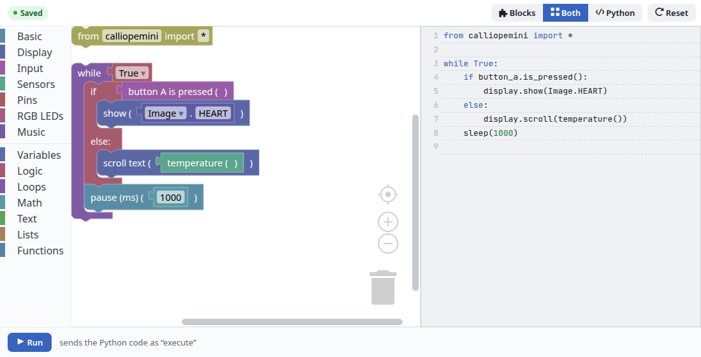

# Edrys Blockly MicroPython Module

Program the **Calliope mini** in MicroPython with blocks, as text, or both side by side, in an Edrys class.
A change in the blocks rewrites the Python, and a change in the Python rebuilds the blocks, so students can
start with blocks and move on to text at their own pace. With `synchronize`, everyone in a room edits **one
shared program**; without it, each person builds their own. The run button sends the Python code to the room,
for example to [module-micropython-simulator](https://github.com/edrys-labs/module-micropython-simulator) or to
a terminal module at the station that flashes the board.



The editor is [BlockMirror](https://github.com/blockpy-edu/BlockMirror) (Blockly and CodeMirror, converting in
both directions) with a Calliope toolbox and an Edrys layer on top.

## Usage

Add the module to your class with this URL:

```
https://edrys-labs.github.io/module-blockly-micropython/index.html
```

## Configuration

All fields are optional and in the general tab (`config`):

| Field | What it does |
|-------|--------------|
| `code` | The MicroPython program a room (or each person, without `synchronize`) starts with. Without it, programs start empty. |
| `synchronize` | `true`: everyone in a room edits one program together. Off (the default): each person builds their own program, kept in their browser. |
| `mode` | The view the editor opens with: `split` (blocks and Python side by side, the default), `block` or `text`. Everyone can switch with the buttons in the top bar. |
| `runCommand` | The message subject the run button sends the code with. Default: `execute`. |

``` yaml
config:
  synchronize: true
  mode: split
  runCommand: execute
  code: |
    from calliopemini import *

    while True:
        if button_a.is_pressed():
            display.show(Image.HEART)
        else:
            display.scroll(temperature())
        sleep(1000)
```

`synchronize` is off by default, as in the other Edrys modules, because the settings form saves `false` for a
checkbox you leave unticked: **working on one program together needs `synchronize: true`**.

Problems with the configuration (an unknown mode, settings that are not valid JSON/YAML) are shown in a red
banner below the editor, and the status in the top bar shows "Error".

## In class

* __Blocks and text.__ Dragging a block writes its Python, including the import it needs (`from calliopemini
  import *`, `import music`, `import neopixel`, `import random`), once. Typing Python rebuilds the blocks 0.3
  seconds after the last key. Code that has no block of its own (or does not parse yet) still works: it is shown as a generic
  block, and the run button sends the text as it is.
* __One program per room__ (with `synchronize`). All peers in a room see and edit the same program. A change is
  sent to the others half a second after the last edit; the status shows "Sending…" until then and "Saved"
  after. The room keeps the whole program, not single edits: a change that arrives from someone else replaces
  an edit of yours that was not sent yet, so take turns rather than typing at the same time.
* __Late joiners and reloads__ get the room's current program. Changing `code` in the settings (also emptying it)
  starts every room over with the new program.
* __Own programs__ (without `synchronize`). Each person's program is saved in their browser, once per class and
  room, so a reload or a room change does not lose it; another device or a private window starts from `code`.
  The status shows "Local only", or "Not saved in this browser" when the browser refuses to keep it. Changing
  `code` in the settings replaces the saved programs with the new start program.
* __Reset__ goes back to the start program from the settings: for the whole room with `synchronize` (teachers and
  stations only get the button), for yourself without it.
* __Run__ sends the program as plain text with the subject `execute` (or `runCommand`), the same way
  module-monaco-editor does, so the modules that run code from the Monaco editor run it from here too.

## The Calliope toolbox

| Category | Blocks |
|----------|--------|
| Basic | `from calliopemini import *`, `while True`, `sleep`, `print`, `running_time` |
| Display | `display.scroll`, `display.show`, `display.clear`, `display.set_pixel`, `display.get_pixel`, `Image.…`, `Image('…')` |
| Input | buttons A and B: `is_pressed`, `was_pressed`, `get_presses` |
| Sensors | `temperature`, `display.read_light_level`, `microphone.sound_level`, `accelerometer.get_x/y/z`, gestures, `compass.heading` |
| Pins | `read_digital`, `write_digital`, `read_analog`, `write_analog` on `pin0` to `pin3` |
| RGB LEDs | `neopixel.NeoPixel(pin_RGB, 3)`, set a colour, `show`, `clear` |
| Music | `music.play`, `music.pitch`, `music.stop` |

Then the general Python categories: Variables, Logic, Loops, Math, Text, Lists, Functions. Every block of the
Calliope categories is tested on the Calliope mini 3 simulator of module-micropython-simulator. The toolbox is
defined in [js/calliope.js](js/calliope.js).

## Use with the simulator

``` yaml
- url: https://edrys-labs.github.io/module-blockly-micropython/index.html
  config:
    synchronize: true
    code: |
      from calliopemini import *
      print('Temperature:', temperature())
- url: https://edrys-labs.github.io/module-micropython-simulator/index.html
  config:
    board: calliope-mini-3
    execute: execute
```

## Files

| Path | What it is |
|------|------------|
| `index.html` | The page: top bar, editor, error banner, run button |
| `js/calliope.js` | The Calliope toolbox, block labels and colours, import handling |
| `js/editor.js` | BlockMirror: layout, theme, view buttons |
| `js/edrys.js` | The Edrys layer: shared or own program, status, run, reset |
| `css/style.css` | The module's styles on the classroom's colours |
| `vendor/` | Copies of Blockly 10.4.3, BlockMirror and CodeMirror 5, unchanged; each folder's `UPSTREAM` says where from |

The libraries are copied rather than loaded from a CDN, so the module only needs GitHub Pages to work in class.

## Tests

The module is tested in a real edrys-Lite with several peers in
[edrys-module-tests](https://github.com/edrys-labs/edrys-module-tests) (`modules/module-blockly-micropython`).

## License

The module's own code is MIT licensed (see [LICENSE](LICENSE)). Blockly and BlockMirror are Apache-2.0,
CodeMirror is MIT; see the files in `vendor/`.
